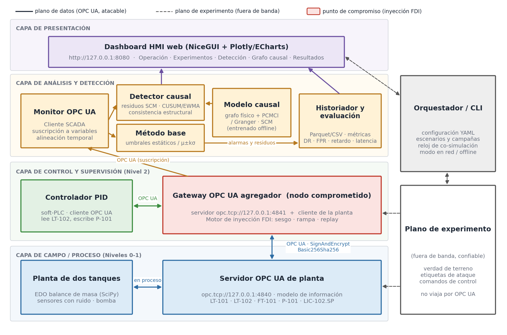

# FDISim-OPCUA — Código fuente

Marco de simulación para la **detección de inyección de datos falsos (FDI) en redes OPC UA mediante análisis causal**.
Proyecto del semillero SIDDFAI (grupo A&C), Universidad de Pamplona.

> **Estado: Fase 0 completada.** La arquitectura, la jerarquía de carpetas, los contratos de datos, las interfaces abstractas, la configuración y las pruebas de aceptación ya están creados. Las funciones que aún no existen lanzan `NotImplementedError` con la fase del plan y el requerimiento que las implementa (p. ej. `"Fase 4 — RF-17: ataque de sesgo"`).

Documentos de referencia (carpeta `Documentacion/` del repositorio):

| Documento | Contenido |
|---|---|
| 01 — Especificación de Requerimientos (ERS) | 55 RF y 24 RNF trazados a los objetivos |
| 02 — Informe OE1 | Revisión de OPC UA y FDI, y selección tecnológica |
| 03 — Plan de Gestión del Proyecto | Fases, sprints, cronograma, riesgos y calidad |

## Arquitectura



Cada componente es un proceso independiente que se comunica por **OPC UA**:

```
Planta (SciPy) ─ Servidor OPC UA de planta :4840 ══ Gateway agregador :4841 ══╦═ Controlador PID (soft-PLC)
                                                   (motor de inyección FDI)   ╚═ Monitor → detectores → HMI web :8080
```

El **gateway** es el nodo autorizado comprometido: con canales `SignAndEncrypt` publica datos falsos válidos.
La verdad de terreno y las etiquetas viajan por un **plano de experimento** separado, nunca por OPC UA.
Detalle en [docs/arquitectura.md](docs/arquitectura.md).

## Estructura

```
Codigo Fuente/
├── config/                 default.yaml · scenarios/ · campaigns/
├── certs/                  certificados X.509 locales (no versionados)
├── data/                   raw/ · processed/ · models/ (no versionados)
├── results/  logs/         reportes, figuras y bitácoras
├── docs/                   arquitectura, modelo de información, guía de experimentos
├── notebooks/              análisis exploratorio
├── scripts/                verificar_entorno.py · generar_certificados.py
├── src/fdisim/
│   ├── cli.py              comandos: run · train · detect · campaign · report · ui · certs
│   ├── common/             contratos de datos (types), config, reloj, plano de experimento
│   ├── process/      M1    modelo de dos tanques, sensores, bomba, perturbaciones
│   ├── control/      M2    PID discreto y soft-PLC cliente OPC UA
│   ├── opcua/        M3    modelo de información, seguridad, servidor de planta, gateway
│   ├── attacks/      M4    sesgo, rampa, replay, sigilo, programador, inyector
│   ├── data/         M5    historiador, almacenamiento con manifiesto, datasets
│   ├── causal/       M6    grafo físico, PCMCI/Granger, comparación, SCM
│   ├── detection/    M7-8  residuos, CUSUM/EWMA, estructura, identificación, umbrales
│   ├── evaluation/   M9    métricas, latencias, campañas, estadística, reportes
│   ├── orchestration/M11   lanzador, ejecución en red y offline
│   └── ui/           M10   HMI NiceGUI: páginas y componentes
└── tests/                  test_estructura.py · unit/ · integration/
```

## Instalación

Requiere **Python 3.12** (compatible con 3.11). No se recomienda 3.14 porque algunas bibliotecas científicas pueden no tener aún versiones para ella.

```bash
py -3.12 -m venv .venv
```

```bash
.venv\Scripts\activate
```

Para que los tres integrantes tengan exactamente las mismas versiones (RNF-08), en Windows instale desde el archivo de versiones fijadas:

```bash
pip install -r requirements-lock.txt
```

```bash
pip install -e . --no-deps
```

En Linux, o para tomar las versiones más recientes compatibles, use en su lugar:

```bash
pip install -e ".[dev]"
```

Verifique el entorno:

```bash
python scripts/verificar_entorno.py
```

Versiones verificadas (17/11/2026): Python 3.12.3, asyncua 1.1.8, NumPy 2.5.5, SciPy 1.18.1, pandas 3.1.1, tigramite 5.2.10.1, statsmodels 0.15.0, scikit-learn 1.9.1, NiceGUI 4.0.0, Plotly 7.1.0.

### Herramientas externas (Fase 1)

Se instalan aparte, fuera de Python:

- **UaExpert** (Unified Automation): cliente OPC UA gratuito para verificar la interoperabilidad (RNF-12). Requiere un registro gratuito en el sitio del fabricante.
- **Wireshark** (con Npcap): para comprobar que el tráfico OPC UA va cifrado (RF-12). En Windows: `winget install WiresharkFoundation.Wireshark`. Para capturar tráfico de `127.0.0.1`, marque la opción de soporte de loopback del instalador de Npcap.

## Pruebas

```bash
pytest
```

Resultado esperado en la Fase 0: las pruebas de estructura pasan; las pruebas de aceptación de fases futuras aparecen como `xfailed` (marcadas con `pending(...)`), y las de integración se omiten si `asyncua` no está instalado. Cuando se implementa una función, su prueba pasa y pytest la reporta como `XPASS(strict)`: es la señal para retirar la marca `pending`.

## Uso previsto

```bash
fdisim run --scenario config/scenarios/sesgo_lt102.yaml --mode network --ui
```

```bash
fdisim campaign --campaign config/campaigns/campana_oe4.yaml
```

```bash
fdisim ui
```

## Mapa de módulos, requerimientos y fases

| Paquete | Módulo ERS | Requerimientos | Fase del plan |
|---|---|---|---|
| `process` | M1 | RF-01 a RF-06 | F2 |
| `control` | M2 | RF-07 a RF-09 | F2, F3 |
| `opcua` | M3 | RF-10 a RF-15 | F1, F3 |
| `attacks` | M4 | RF-16 a RF-24 | F4 |
| `data` | M5 | RF-25 a RF-27 | F3, F4 |
| `causal` | M6 | RF-28 a RF-32 | F5 |
| `detection` | M7, M8 | RF-33 a RF-40 | F6 |
| `evaluation` | M9 | RF-41 a RF-46 | F8 |
| `ui` | M10 | RF-47 a RF-52 | F7 |
| `common`, `orchestration`, `cli` | M11 | RF-53 a RF-55 | F0, F3 |

## Convenciones

- Ramas `feature/RF-17-ataque-sesgo`; commits con Conventional Commits (`feat(attacks): ataque de sesgo (RF-17)`).
- Docstrings en español con los RF que implementa cada función; identificadores de código en inglés.
- `ruff check` y `ruff format` antes de cada pull request; cobertura ≥ 70 % en el núcleo (RNF-17).
- Nuevos ataques o detectores: subclase de `AttackStrategy` o `Detector` con `@register_attack` o `@register_detector` (RNF-16).

## Uso ético

El motor de ataques existe solo para la investigación dentro de este simulador. Los endpoints se ligan a `127.0.0.1` por defecto (RNF-11); no se debe apuntar a sistemas reales.
