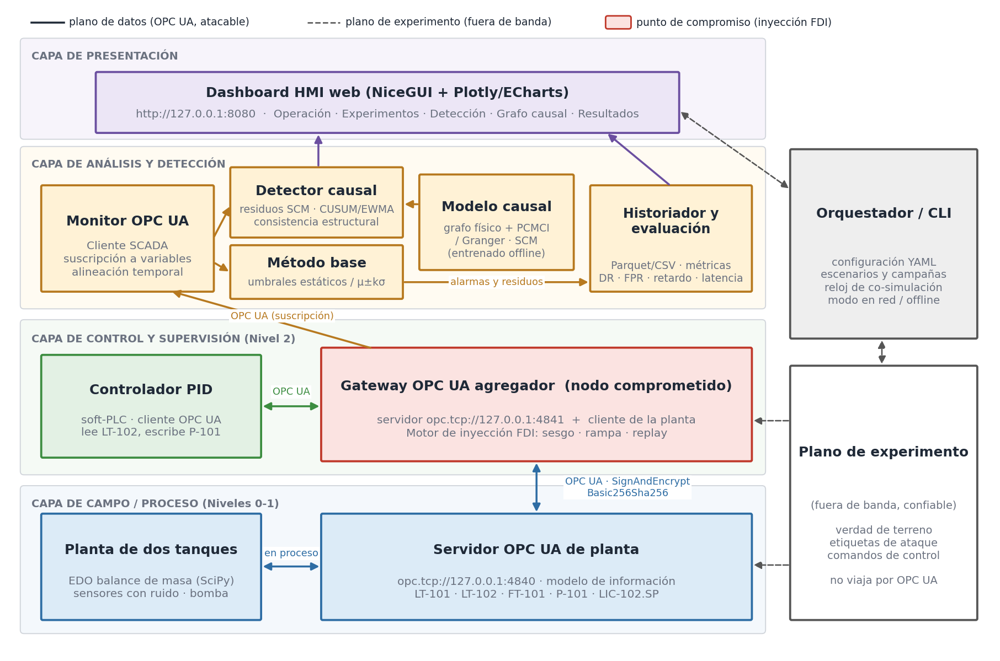
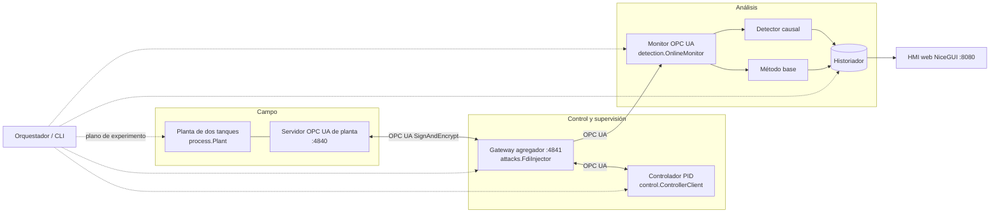
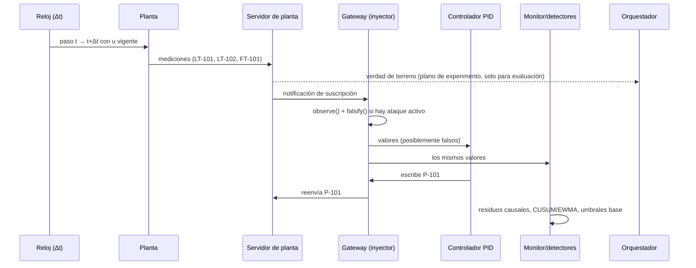

# Arquitectura de FDISim-OPCUA

Resultado de la Fase 0 del Plan de Gestión (Documento 03, §4). Requerimientos: Documento 01 (ERS).

## Principios

1. **Red industrial real en un solo equipo.** Cada componente es un proceso independiente que se comunica por OPC UA sobre TCP local, con la misma pila (asyncua) y la misma seguridad que en un despliegue real.
2. **Plano de datos y plano de experimento separados.** Las variables del proceso viajan solo por OPC UA (y ahí ocurre el ataque). La verdad de terreno, las etiquetas y los comandos del experimento usan colas locales confiables (`common/bus.py`). El detector nunca ve la verdad de terreno.
3. **Nodo comprometido realista.** El ataque ocurre en un gateway agregador autorizado, que termina el canal seguro en cada salto. Por eso los datos falsos llegan firmados y cifrados (Informe OE1, §3.6).
4. **Un solo código para los modos en red y offline.** Planta, inyector y detectores son las mismas clases; el modo offline solo elimina la red, para hacer campañas grandes y reproducibles (RF-38).
5. **Extensibilidad por registro.** Ataques y detectores se registran por nombre (`@register_attack`, `@register_detector`) sin tocar el núcleo (RNF-16).

## Componentes y flujo

| Componente | Proceso | Endpoint | Paquete |
|---|---|---|---|
| Servidor de planta + planta | `plant_server` | `opc.tcp://127.0.0.1:4840/fdisim/planta` | `opcua.plant_server`, `process` |
| Gateway agregador + inyector | `gateway` | `opc.tcp://127.0.0.1:4841/fdisim/gateway` | `opcua.gateway`, `attacks` |
| Controlador PID | `controller` | cliente del gateway | `control` |
| Monitor + detectores | `monitor` | cliente del gateway | `detection` |
| HMI | subproceso `python -m fdisim ui` (cliente del gateway) | `http://127.0.0.1:8080` | `ui` |
| Orquestador | proceso principal (CLI) | — | `orchestration`, `cli` |

Cada servidor solo admite a sus clientes legítimos (certificado en su lista de confianza y usuario
permitido): la planta, al gateway; el gateway, al controlador, al monitor y a la HMI. El usuario
`uaexpert` queda habilitado en ambos para las pruebas de interoperabilidad.

## Secuencia de un paso de co-simulación

## Decisiones de implementación de la co-simulación (Fase 3)

- **SourceTimestamp = instante programado del paso.** El reloj espera hasta instantes absolutos `inicio + k·Δt/escala` y el servidor de planta publica cada medición con ese instante. Así, cada muestra OPC UA se une sin ambigüedad con su registro de verdad de terreno, y las latencias por salto se miden con las marcas de tiempo OPC UA.
- **Una notificación por paso.** El gateway y el monitor se suscriben con el disparador `StatusValueTimestamp` y cola sin límite: llega cada paso aunque el valor se repita, sin pérdidas entre publicaciones.
- **Escrituras de los clientes.** El gateway detecta las escrituras sobre P-101 y la consigna con la retrollamada `PostWrite` de asyncua y las reenvía a la planta en orden, conservando su SourceTimestamp. La planta nunca reescribe esos nodos, para no pisar una escritura concurrente.
- **Consigna.** El servidor de planta aplica los cambios programados en el escenario; un cambio desde la HMI se mantiene hasta el siguiente cambio programado.
- **Controlador.** Calcula cada `Ts` de tiempo simulado. No calcula mientras la simulación no corre, y sin datos frescos mantiene la última salida y lo registra.
- **Arranque y parada.** El orquestador lanza cada componente con `multiprocessing` (contexto *spawn*), espera su READY y da la orden de inicio a la planta. Al terminar, deja un margen para los datos en tránsito y detiene en orden inverso. Ctrl+C lo atiende solo el orquestador, para que cada componente guarde sus datos.
- **HMI como subproceso.** NiceGUI no puede ejecutarse dentro de un proceso hijo de `multiprocessing`, por eso la HMI se lanza como `python -m fdisim ui`.

## Contratos de datos

Definidos en `src/fdisim/common/types.py`: `Sample`, `GroundTruthRecord`, `AttackSpec`, `StealthSpec`, `AttackEvent`, `Alarm`, `RunManifest`. Son la interfaz estable entre módulos; cambiarlos exige acuerdo del equipo y actualizar las pruebas. En la Fase 3, `GroundTruthRecord` ganó el campo opcional `source_ts` (compatible con lo anterior), que permite unir cada paso con sus muestras OPC UA.

## Decisiones tecnológicas

Justificación completa en el Informe OE1 (§7): Python 3.12, asyncua, NumPy/SciPy, tigramite (PCMCI), statsmodels (Granger), scikit-learn, networkx, pandas/pyarrow y **NiceGUI** como HMI web local. NiceGUI se eligió frente a una ventana Tk porque corre sobre el mismo bucle asyncio que asyncua y envía las actualizaciones al navegador por websockets.
