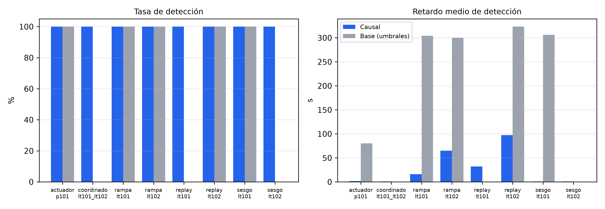
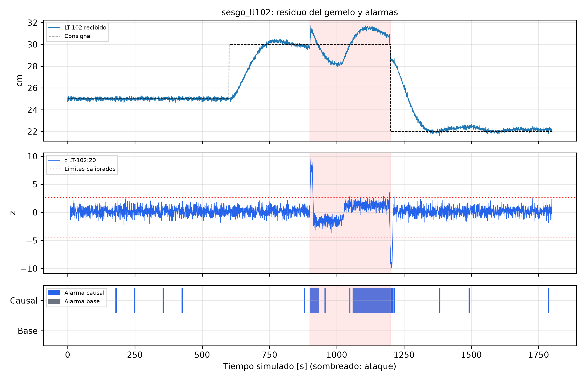

# Guía del detector causal y del método base (Fase 6)

El detector compara lo que llega por OPC UA con lo que la física del proceso permite. Usa el modelo causal de la Fase 5 (`data/models/causal_v1`) y corre en paralelo con un método base de umbrales sobre exactamente las mismas muestras (RF-40).

## 1. Uso

**Calibrar.** `fdisim train` calibra los detectores al terminar el entrenamiento y deja `detector.json` junto al modelo. Si ese archivo falta, cualquier comando de detección lo crea con el dataset de origen del modelo. Para forzar una recalibración:

```bash
fdisim detect --data data/processed/v1/test.parquet --recalibrar
```

**Evaluar sobre el dataset de prueba** (8 escenarios de ataque y corridas normales). Genera tablas, figuras y `report.md` en `results/deteccion_v1/`:

```bash
fdisim detect --data data/processed/v1/test.parquet
```

**Reprocesar una corrida guardada** (en red u offline). Los resultados quedan en `<corrida>/detection/`:

```bash
fdisim detect --run data/raw/<run_id>
```

`fdisim run` hace esto mismo al terminar cada corrida; se puede omitir con `--sin-deteccion`. En red, el monitor detecta además en línea, y el reprocesamiento verifica que las alarmas coincidan (RF-38).

## 2. Cómo decide el detector causal

### Residuos (RF-33)

Se calculan sobre la rejilla de 0,5 s, a partir del SCM físico-informado.

| Residuo | Qué compara | Para qué sirve |
|---|---|---|
| `LT-101:1`, `LT-102:1` | el nivel medido contra el balance de masa a un paso | cambios bruscos |
| `FT-101:1` | el caudal medido contra la bomba de primer orden alimentada con la orden P-101 | ataques al actuador o al caudal |
| `P-101:1` | la orden contra la ley PI incremental | **informativo, no decide** |
| `LT-101:20`, `LT-102:20` | el nivel medido contra el **gemelo causal**, que integra el nivel 10 s desde su valor pasado con sus padres observados | inicio del ataque y sesgos |
| `LT-101:120`, `LT-102:120` | lo mismo, con 60 s de horizonte | desviaciones lentas: rampas y replay |

**Por qué funciona el gemelo.** Un sesgo sobre un nivel desplaza el punto de partida del gemelo, pero no la física que lo gobierna. Por eso la diferencia entre el valor observado y el simulado crece con el horizonte. El residuo a un paso no basta: ante un sesgo sigiloso sobre LT-102 su valor apenas se mueve (z = 0,3, hallazgo de la Fase 5).

**Normalización.** Cada residuo se normaliza con la media y la desviación de los datos de entrenamiento.

**Por qué P-101:1 no decide.** En red, el controlador muestrea el nivel en su propio instante, no en la rejilla. Su residuo refleja entonces el ruido de dos muestras distintas: z ≈ ±100 con límites calculados fuera de línea, donde ambos instantes coinciden. Por la misma razón, `FT-101:1` tolera el instante en que se aplica la orden: mide la distancia del caudal al intervalo comprendido entre «orden aún no aplicada» y «orden aplicada todo el periodo».

### Decisión y alarmas (RF-34, RF-36)

- **Reglas.** Cada residuo tiene un umbral asimétrico, porque las perturbaciones legítimas desplazan algunos residuos en un solo sentido. Los residuos a un paso tienen además CUSUM bilateral (k = 0,5) y EWMA (λ = 0,2). El CUSUM se satura en 1,5·h para que se recupere en segundos cuando termina un ataque.
- **Calibración.** Todas las reglas usan el mismo nivel de excedencia ε. Se busca por bisección el mayor ε con el que el FPR combinado en validación, ya con la retención de 2 s, no supera el objetivo: `detection.decision.target_fpr = 0,5 %`. El valor medido en validación fue 0,46 %.
- **Arranque.** Durante los primeros 60 s de cada corrida (la historia del horizonte largo) no se emiten alarmas.
- **Alarma.** Cada alarma registra el instante de inicio y de fin, el detector, el tipo de regla (residuo, CUSUM o EWMA), las variables implicadas, la severidad (la mayor razón estadístico/límite), la variable sospechosa y el estado (activa, reconocida o cerrada).

### Identificación (RF-37)

La variable sospechosa es aquella cuya firma explica mejor las variables con residuos en alarma, ponderadas por severidad:

| Variable atacada | Residuos que se alteran |
|---|---|
| LT-101 | LT-101 y su hijo LT-102 |
| LT-102 | solo LT-102 (el controlador y el monitor reciben el mismo valor falso) |
| FT-101 | FT-101 y LT-101 |
| P-101 (orden alterada, eco oculto) | solo FT-101 |

### Método base (RF-40)

Alarma cuando una variable sale de sus límites operativos o de μ ± 3σ, estimados con datos normales. Usa la misma retención. Su «identificación» es la variable que se salió de los límites.

## 3. Resultados (dataset v1, 24/11/2026)

Prueba: 16 ataques (8 escenarios × 2 corridas) y 3 corridas normales de 30 min con perturbaciones legítimas.

| Indicador | Causal | Base (umbrales) |
|---|---|---|
| Tasa de detección (DR) | **100 %** | 62,5 % |
| Retardo medio / mediano | **26,8 s / 5,2 s** | 262,8 s |
| FPR en corridas normales | 1,0 % | 0,4 % |
| Falsas alarmas por hora (normales) | 17,3 | 4,0 |
| Identificación correcta | **93,8 %** | 10 % |
| Procesamiento p95 por muestra | 0,14 ms | 0,01 ms |

El método base no detecta el sesgo sobre LT-102, el ataque coordinado ni el replay sobre LT-101: en esos casos los valores falsos se mantienen dentro de los límites, porque el sigilo los confina a la envolvente. Las detecciones que sí logra llegan casi siempre al final del ataque.

Se cumplen las metas indicativas de RNF-24: DR ≥ 90 %, FPR ≤ 2 % y un retardo menor que el del método base.





**En red (co-simulación a 5×).**

- **Ataque interactivo desde la HMI** (sesgo de +2 cm sobre LT-102, con sigilo): detectado al inicio, con LT-102 identificada. El método base no lo detectó.
- **RF-38:** las 10 alarmas del monitor en línea coinciden con las 10 del reprocesamiento, con una diferencia de 0,0 s.
- **Tiempo de procesamiento:** p95 = 0,58 ms.

## 4. Límites y trabajo futuro

- **FPR en red.** Es mayor que fuera de línea, porque la calibración usa corridas offline. Calibrar con corridas en red lo reduciría.
- **Perturbaciones legítimas.** El cambio del área de salida y la fuga producen la mayoría de las falsas alarmas: físicamente se parecen a un ataque lento.
- **Diferidos a la v2.** La verificación estructural por ventanas (RF-35) y la marca de agua física (RF-39). Ver [alcance_v1.md](alcance_v1.md).
